# Hold My Loot, build 30: the "before" audit

Written 25 October 2026 against the build 30 `index.html` in this repo (meta tag confirmed `hml-build=30`).
Nothing in the game has been changed yet. This is what a stranger from a Reddit post hits in the first ten minutes,
ranked by how many of them I think it loses, with the fix for each.

## How it was tested

- Playwright drove the real `index.html` at iPhone SE (375x667), iPhone 15 (393x852), Pixel 8 (412x915) and a 1280px
  desktop: first launch, the taster, Levels 2 and 3, Long Nap, Raid, Wardrobe, Shed, Gear, Odd jobs, menu tabs,
  feedback, refresh mid-level, continue, pause, background tab, landscape, dark mode, reduced motion, blocked storage and
  the self-update from a simulated build 29. Scripts: `tests/tour.mjs`, `tests/tour2.mjs`, `tests/tour3.mjs`.
  Full screenshot sets are in `review/before/<viewport>/` (not committed, 200 MB); the ones this audit cites are in
  `review/img/audit/`.
- The simulation block was loaded headless in Node, as-is from `index.html`, and played thousands of times with
  simple player behaviours (`tests/taster-sim.mjs`, `tests/balance.mjs`). These are bots, not people, but they are
  deterministic and they expose the shape of the problem.
- Startup was measured with a 4x CPU slowdown and a 4G profile (`tests/perf-startup.mjs`), and Lighthouse 12 mobile
  ran against a gzip-serving local copy (`tests/serve.mjs`), the way GitHub Pages serves it.

### The numbers that matter

Taster (the brand-new player's 3-wave first game), 300 runs each, what happens depending on which face the player taps
for their second hire:

| Second hire after the free Dazza | Wins | Average pile kept of 10 | Kevin reaches Gary |
|---|---|---|---|
| Dazza (what the coach points at) | 96% | 4.1 | every run, takes 4 |
| Big Marg | 97% | 3.9 | every run, takes 4 |
| Nan Beryl (the "recommended", overpowered pick) | **14%** | 0.3 | his crit-spawned rats clean the pile out |
| Nan then a third Dazza | 58% | 2.1 | |
| Uncle Tony (SPEED BOOST looks like the obvious pick) | **2%** | 0.0 | |

A coach-following player who also upgrades between waves: 100% wins, median pile 6, 93% get 2 stars and the rest 3,
and finishes with about 290 unspent gold.

Chapter 1 with a coverage-aware human-style bot (40 runs per level, auto-recommended crew which includes Nan):
Level 1 100%, 2 98%, 3 100%, 4 100%, 5 93%, 6 (The Laneways) **40%** losing on waves 2 and 3, 7 98%, 8 95%.
Without Nan: 100/100/95/85/90/83/100/100. The Laneways is a wall for the recommended crew and needs a look in step 2.

Startup, Pixel 8 profile, CPU 4x, 4G:

| | ms |
|---|---|
| First paint | 612 |
| Google Fonts stylesheet (render-blocking) | 509 |
| Longest main-thread task (pallet layout + parse) | **1972** |
| Game interactive (start button enabled) | **3330** |

Lighthouse 12 mobile (gzip, 189 KB): Performance **62**, Accessibility 94, Best Practices 96, SEO 100.
FCP 3.6 s, LCP 4.4 s, TTI 4.4 s, main-thread work 8.3 s, render-blocking fonts 0.85 s, CLS 0.
Accessibility failures: `aria-prohibited-attr` on the pile pips div, label mismatch on the speed button.

Self-update: a page served as build 29 discovered 30 and reloaded to `?v=30` on all four viewports. Refresh mid-level,
continue, pause and background-tab all behaved. No page errors in any run.

## The fifteen worst things in the first ten minutes

### 1. The first game is a coin flip decided by which face the player taps

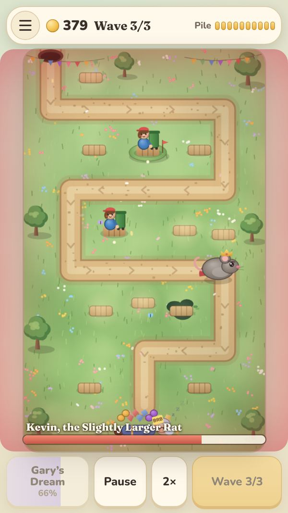

The taster is only "nearly unlosable" if the player hires a second Dazza or Marg. Tap Nan, the character the game
itself calls the raw-power pick and shows with a crown of CRITS, and 86% of first games are lost: each crit on Kevin
spawns two rats, two tier-0 towers cannot kill them, and the rats empty the pile. Tap Uncle Tony and 98% are lost
because he does no damage. Even on the "good" path Kevin walks into Gary every single run and takes four items.
Players lost: the most of anything here, and they never come back.
Fix: during the grace run Kevin does not spawn rats on crits (or his split is capped at one pair) and his HP is tuned
so any two starter hires kill him before the pile; Tony is hidden from the taster build sheet or the coach steers to
damage first. Nan stays exactly as she is. Verified by `tests/taster-sim.mjs` after the fix: every second-hire choice
must win with 8+ kept.

### 2. "FIRST WIN!" with one star and "Gary kept 4/10" reads as a loss

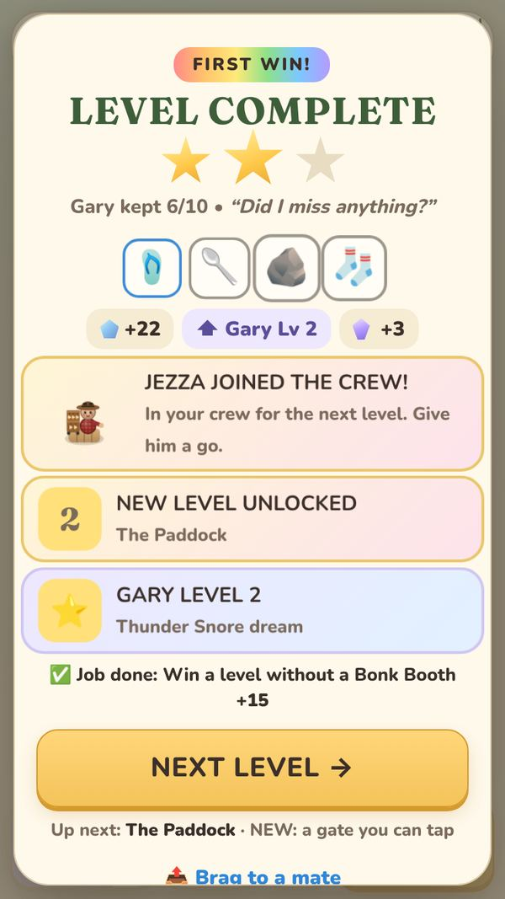

The rainbow ribbon says win; the two grey stars and 4/10 say you failed. Nobody who has played a mobile game reads one
star as a success, and this is the screen the player decides to continue on. Fix: the taster is scored as the
celebration it is meant to be (Kevin never reaches Gary, so it is 3 stars honestly), the first results screen leads with
the loot and the new crew member, not the star row.

### 3. Three and a half seconds of nothing on a mid-range phone

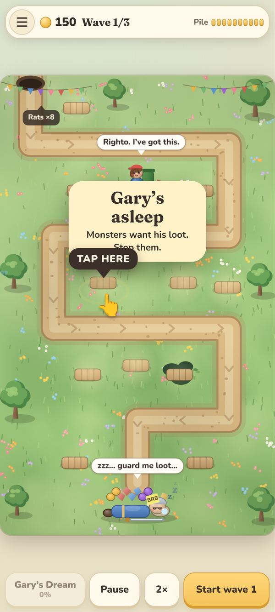

A single 2-second main-thread task (the pallet layout for all 28 maps) runs before the game can respond, after a
render-blocking fonts fetch. On a real 4G Android it is 3.3 to 4.4 s of beige before anything moves, with no splash,
no progress, no title. A share of Reddit traffic closes the tab here. Fix: lazy pallet layout (compute the first map,
the rest in idle time), fonts preloaded with `font-display: swap` and a system fallback that does not reflow, an instant
CSS splash with Gary snoring, and a service worker so every launch after the first is instant and works offline.

### 4. The coach stops teaching after the second hire and the player ends the taster with 290 gold unspent

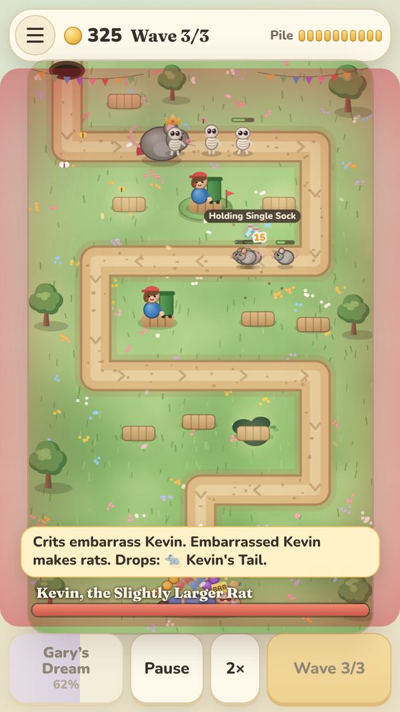

After "Another one!" there is no further nudge during waves. The upgrade coach step only fires between waves, and the
taster auto-starts the next wave 2.2 s later, so it never shows. The player has 278 gold in the screenshot and two
Dazzas while a skeleton walks into Gary. Fix: the coach points at gold the moment the player can afford a hire or an
upgrade during a wave ("You've got 85 gold: tap Nan's pallet"), the taster pauses auto-start while a coach step is
visible, and the upgrade is taught inside the taster.

### 5. The first sentence the player reads is a theft

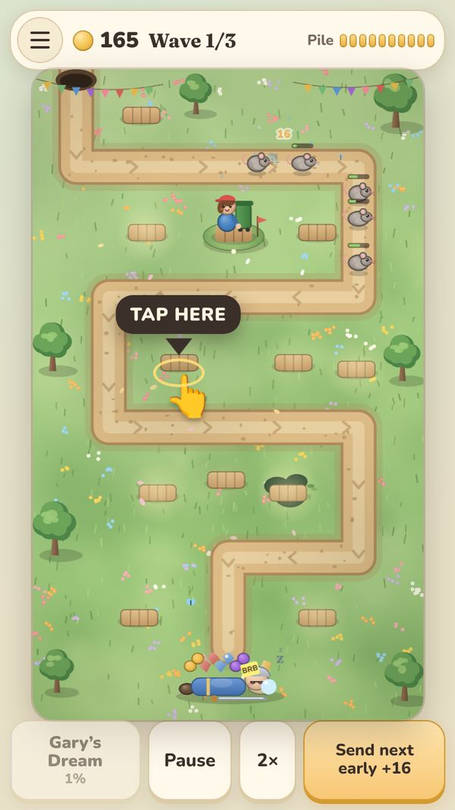

Six seconds in, before the loot-tap lesson, the guaranteed Decent drop lands under the next rat, which picks it up and
the toast says "Rat (Regular) grabbed Thong of Swiftness and is using it." The player has not been told loot exists.
Fix: in a first run the guaranteed drop is untouchable by monsters until the player has tapped one piece of loot
(or for 6 s), the coach's TAP THE LOOT step fires on that drop, and the first heist line is reworded as a lesson.

### 6. The welcome banner covers the first coach arrow

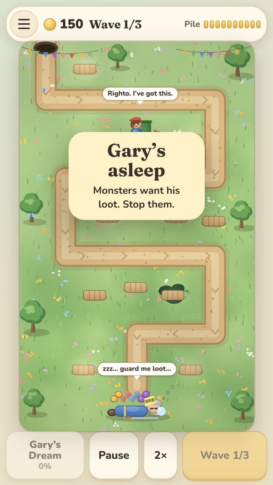

"Gary's asleep. Monsters want his loot. Stop them." sits exactly on top of TAP HERE and over Dazza's "Righto. I've
got this." bubble. The two things the player needs to read first cancel each other out. Fix: sequence them (banner
1.5 s, then the coach), move the banner above the road, and never show two overlays at once.

### 7. Settings, mute and the save code are unreachable from the home screen

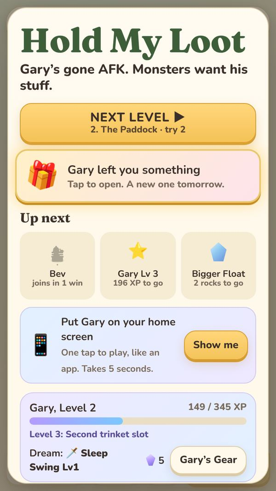

The hamburger is underneath the home modal (a hit-test on its centre returns the modal title on all three phones) and
the home card has no Settings link. Music starts on the first tap and the only way to turn it off is to start a level,
open the menu and find the Settings tab. Fix: a visible Settings entry on the home card, a one-tap mute on the HUD that
persists, and the hamburger raised above the modal.

### 8. Level 2 is a cliff and the loss screen blames the wrong thing

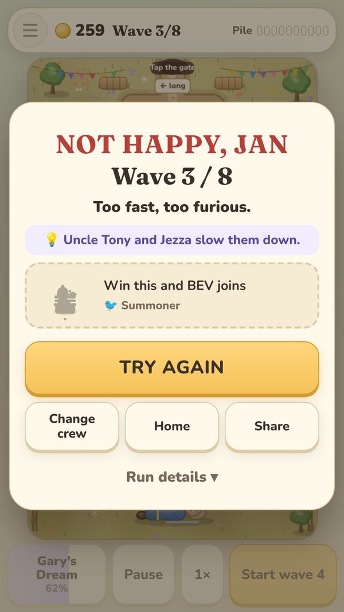

The bots that hoarded gold or built in the centre column lost The Paddock on wave 3 (the 12-mozzie pack) with 230 to
280 gold unspent. The diagnosis says "Too fast, too furious. Uncle Tony and Jezza slow them down." The real reason was
unspent gold and towers that could not reach the long road. Fix: the diagnosis checks unspent gold and road coverage
before monster type, the Paddock's wave-3 mozzie pack is trimmed, and the gate gets a coach tap on the first visit.

### 9. On desktop the game is a phone in a beige void

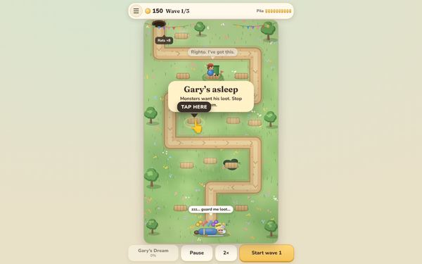

At 1280px the game is a 430px column with nothing around it, the copy says TAP, and there are no keyboard shortcuts.
CrazyGames and itch traffic is mostly desktop. Fix: the desktop frame already planned for build 31 (wordmark, how to
play, crew, keyboard shortcuts, pointer cursor, CLICK wording), none of which exists in this repo yet.

### 10. The home screen buries Play under three cards on an iPhone SE

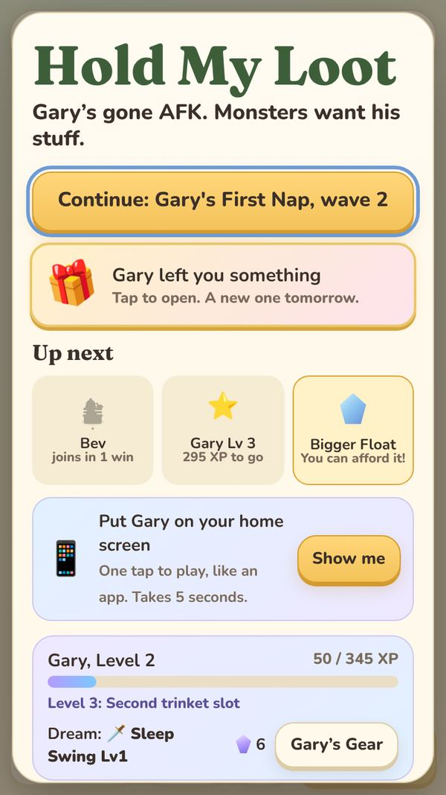

Above the fold: title, NEXT LEVEL, a wiggling gift, Up next, and a "Put Gary on your home screen" card, all before
the player has played twice. Levels, modes and How to play are four screens down. Fix: Play first, one promotional card
at a time, the home-screen install card only from the second session, Odd jobs and Shed folded until they matter.

### 11. The installed app does not open on a plane, and a blocked-storage browser is told nothing until a wave ends

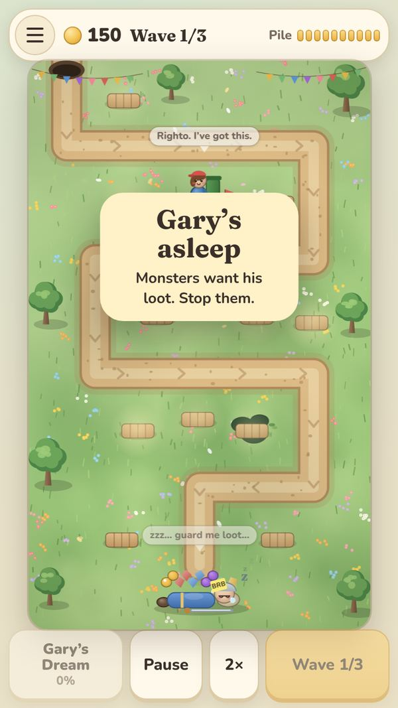

There is no service worker, so "Add to Home Screen" gives a browser error page with no network. In a private tab or a
chat-app browser the taster plays normally and only warns after wave 1, so a player can finish the taster and lose
it on refresh. Fix: a service worker that caches the shell and cooperates with the build-number check, and the storage
warning shown before the first win is at risk.

### 12. Pause is invisible

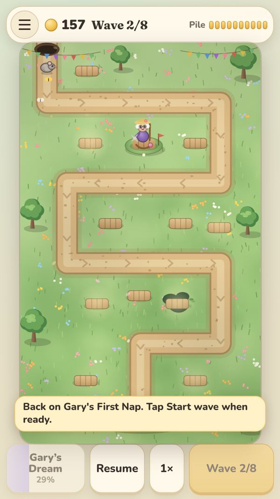

Tapping Pause changes one button label to Resume. The board does not dim, there is no "paused" state, and a player who
backgrounds the app and comes back does not know whether it is running. Fix: a dimmed overlay with a Resume button and
the level name, and the same overlay when the tab was hidden during a wave.

### 13. Tall phones letterbox the map and shrink the controls

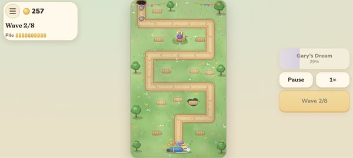

On a Pixel 8 the 360x600 board leaves 110 px of empty beige above and below the map; in landscape the map is clipped at
the top and the buttons float in space. Fix: let the board use the extra height (taller canvas viewport with the road
geometry unchanged), put the HUD in the dead space, and give landscape a proper two-column frame.

### 14. The build sheet overlaps the coach and hides half the map

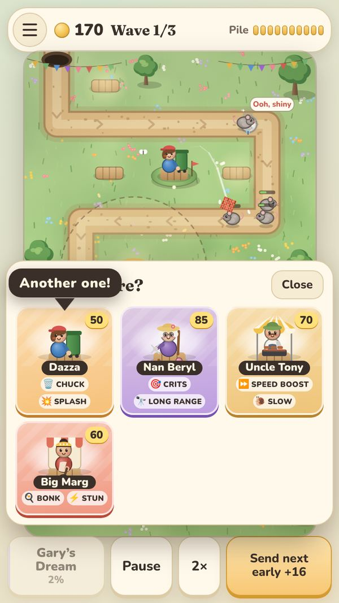

"Another one!" sits on top of "Who goes here?", and the sheet covers the bottom half of the road while a wave runs, so
the player cannot see what they are reacting to. Fix: the sheet opens on the opposite side from the tapped pallet,
is shorter (one row of faces), and the coach anchors to the card, not the header.

### 15. Analytics are on by default with no privacy page and no consent

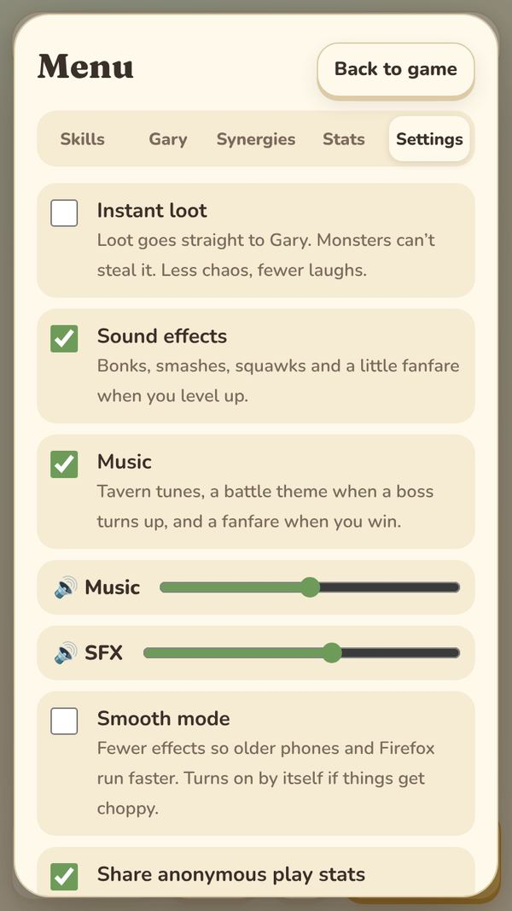

PostHog starts on first load; the only control is a checkbox three taps deep, and there is no privacy page anywhere,
which an EU Reddit audience will notice and a store listing will require. Fix: a cookie-free, personal-profile-free
configuration (already the case technically), a privacy page, and a one-line first-session notice with an off switch.

## Also found, outside the first ten minutes

- **A corrupted paste in the simulation** (`index.html` lines 2748 to 2760): inside the splash-projectile branch a copy
  of the road-spikes tick and the start of the enemy loop was pasted over the splash loop header. Every time one of
  Dazza's splashing throws lands, spikes lose life and hit again, curse timers tick, Raid damage accounting runs and
  healers heal. It does not crash, which is why nobody saw it. Gav's spikes are visibly weaker whenever Dazza is near.
- **The Laneways** loses 60% of bot runs on waves 2 and 3 with the recommended crew. Needs a real look in step 2.
- After the taster ends, the HUD reads "Start wave 4" of 3 and the coach says "Tap to upgrade" for 1.4 s before the
  results appear.
- The Long Nap unlocks after one win and a player with three tier-0 towers dies on wave 3 and is told "New best this
  week! · all-time best!". True, but it reads as sarcasm.
- Merchant event state is cleared on the next wave start, so the cart only exists during the wave it rolled; fine, but
  the home "How to play" never mentions it.
- 27 CSS animations, 3 `prefers-reduced-motion` guards. No haptics. No `noscript`. No apple splash images.
- Dark mode only darkens the page behind the cards; the game is light-only by design, which is fine, but the
  `color-scheme: light` plus a dark page gradient looks like a half-finished theme.
- Known from DESIGN.md and confirmed in code: Heat 0 row, the dead Select button from the mastery goal, the stale Raid
  start button, the free Dazza not firing `tower_placed`.

## What I need from you before going further

See the questions in the chat message that accompanies this audit.
